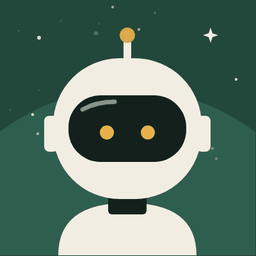

**Amad**, building at night. 
I build AI agents and the tools they work in: shared memory, live maps, and CRMs where people and agents work side by side.

 

## Projects

- **[Fogpin](https://fogpin.com)**: a live map of San Francisco and Bay Area events, about 900 a week, refreshed daily.
- **Fogpin MCP** (`https://mcp.fogpin.com/mcp`): a public MCP server that lets AI assistants search the Fogpin events data.
- **[reddit-research-mcp](https://github.com/ahmedamad111/reddit-research-mcp)**: an MCP server that searches and reads Reddit threads for research.
